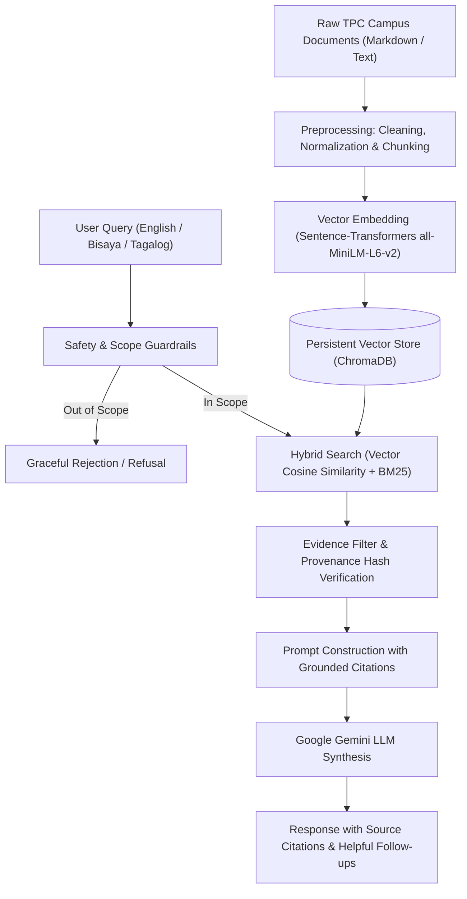

# TPC NavBot: Intelligent Campus Navigation & Knowledge-Base RAG Assistant

[](https://tpcnavbottt-86x6mfwrmyvliw3xgpg2qp.streamlit.app/)
[](https://opensource.org/licenses/MIT)
[](https://www.python.org/)

> **IS Professional Elective #4 — Generative AI Capstone Project**  
> **Institution**: Talibon Polytechnic College (TPC), San Isidro, Talibon, Bohol  
> **Live Deployed Web Application**: [https://tpcnavbottt-86x6mfwrmyvliw3xgpg2qp.streamlit.app/](https://tpcnavbottt-86x6mfwrmyvliw3xgpg2qp.streamlit.app/)  
> **GitHub Repository**: [https://github.com/randeleners4u/TPCNAVBOTTT](https://github.com/randeleners4u/TPCNAVBOTTT)  

---

## 🌐 1. Live Application Access
You can open and interact with **TPC NavBot** directly online without logging in or installing anything:
👉 **[Open TPC NavBot on Streamlit Community Cloud](https://tpcnavbottt-86x6mfwrmyvliw3xgpg2qp.streamlit.app/)**

### Supported Multilingual Querying:
- **English**: e.g., *"Where is the Office of the Registrar?"*, *"What are the admission requirements for BSIS?"*
- **Bisaya / Boholano**: e.g., *"Asa dapit ang opisina sa BSIS?"*, *"Unsa ang mga rekisitos sa enrollment?"*
- **Tagalog**: e.g., *"Saan makikita ang Guidance Office?"*, *"May pasok ba sa Sabado?"*

---

## 🎯 2. Project Purpose & Problem Statement
Students, freshmen, transferees, and campus visitors at **Talibon Polytechnic College (TPC)** frequently experience difficulty locating decentralized administrative offices, academic departments, laboratory rooms, and student support services across the campus.

**TPC NavBot** solves this by implementing a **Production-Grade Retrieval-Augmented Generation (RAG)** pipeline. Instead of relying on generic Large Language Model (LLM) guesswork that risks hallucinating non-existent buildings or outdated policies, TPC NavBot strictly grounds every response in reviewed school records. If a route, facility, or fee is not verified in official records, the bot explicitly reports it as unverified and directs the student to the responsible office.

---

## 🛠️ 3. Tech Stack
| Component | Technology | Description |
| :--- | :--- | :--- |
| **Frontend / Web UI** | [Streamlit](https://streamlit.io/) | Lightweight, responsive single-page chat interface with custom CSS |
| **Embedding Model** | [Sentence-Transformers](https://sbert.net/) (`all-MiniLM-L6-v2`) | Dense 384-dimensional vector embeddings with lexical hashing fallback |
| **Vector Database** | [ChromaDB](https://www.trychroma.com/) | Persistent vector store with SQLite metadata indexing and similarity search |
| **LLM & Generation** | [Google Gemini](https://ai.google.dev/) (`gemini-3.5-flash-lite`) | Generative response synthesis via official `google-genai` SDK |
| **Orchestration** | [LangChain Core](https://python.langchain.com/) | Retrieval augmentation, context passing, and multi-turn session memory |
| **Guardrails & Safety** | Custom Rule & Boundary Engine | Prompt injection detection, scope enforcement, and out-of-scope refusal |
| **Hosting Platform** | Streamlit Community Cloud | Continuous deployment synchronized with GitHub `main` branch |

---

## ⚙️ 4. How the RAG Pipeline Works

The RAG pipeline ensures answers are factual, auditable, and traceable back to original documents:



1. **Ingestion & Chunking**: Source documents are cleaned, normalized, divided into semantically coherent chunks (preserving paragraph integrity), and stamped with SHA-256 hashes in `data/source_registry.json`.
2. **Embedding & Storage**: Text chunks are embedded into 384-dimensional dense vectors using `all-MiniLM-L6-v2` and stored in a persistent ChromaDB database.
3. **Guardrails & Query Understanding**: Every user query is inspected for prompt injection, sensitive system queries, and out-of-scope topics. Language is detected automatically (English, Bisaya, Tagalog).
4. **Retrieval**: ChromaDB retrieves top-$k$ nearest vector chunks based on cosine distance, complemented by keyword/alias matching for campus buildings.
5. **Grounded Generation**: Gemini synthesizes the answer using **only** retrieved context chunks. When information is absent from the documents, the system acknowledges the gap without inventing answers.

---

## 📚 5. Source Documents & Knowledge Provenance
The knowledge base comprises **30+ verified campus records** located in [`TPC Navbot/data/raw/`](TPC%20Navbot/data/raw/):
- **Official TPC Student Handbook**: Academic policies, grading systems, attendance rules, dress code, and code of conduct.
- **Campus Facility Records**: Office locations, laboratories (ComLab, Forensic Ballistics, Agri hub), library learning center, gymnasium, clinic, and canteen.
- **Department & Program Directories**: BS in Information Systems (BSIS), BS in Accounting Information Systems (BSAIS), BS in Criminology (BSCRIM), BS in Agriculture (BSA), BA in English Language (BAEL), BA in Political Science (BAPS), and Bachelor of Early Childhood Education (BECED).
- **School-Confirmed Verifications**: Reviewed against administrative references with reviewer and date metadata tracked in [`TPC Navbot/data/submissions/`](TPC%20Navbot/data/submissions/).

---

## 🚦 6. Usage Limits & API Quotas
- **Free-Tier API Quota**: This application uses Google Gemini's free-tier API, subject to a limit of **15 Requests Per Minute (RPM)** and **1,500 Requests Per Day (RPD)**.
- **Application Rate Limiter**: To prevent service disruption and respect free-tier quotas, TPC NavBot enforces a client-side limit of **12 messages per minute per session** (and 120 messages/min instance-wide). If exceeded, a temporary wait timer is displayed.
- **Offline / Fallback Capability**: If API keys or external services are unavailable, the application gracefully operates in a deterministic offline mode using pre-indexed verified campus records.

---

## 🚀 7. Running Locally

### Prerequisites
- Python 3.10, 3.11, or 3.12
- Git

### Step-by-Step Setup

1. **Clone the Repository**:
   ```bash
   git clone https://github.com/randeleners4u/TPCNAVBOTTT.git
   cd TPCNAVBOTTT
   ```

2. **Create and Activate a Virtual Environment**:
   ```powershell
   # Windows PowerShell
   python -m venv .venv
   .\.venv\Scripts\Activate.ps1
   ```
   ```bash
   # macOS / Linux
   python3 -m venv .venv
   source .venv/bin/activate
   ```

3. **Install Dependencies**:
   ```bash
   pip install -r requirements.txt
   ```

4. **Set Up Environment Variables**:
   ```powershell
   # Copy the example environment file
   Copy-Item .env.example .env
   ```
   Open `.env` in any text editor and optionally add your [Google Gemini API Key](https://aistudio.google.com/app/apikey):
   ```env
   GEMINI_API_KEY=your_actual_gemini_api_key_here
   ```
   *(Note: The app will still run in deterministic offline mode if left empty).*

5. **Run the Application**:
   ```powershell
   cd "TPC Navbot"
   python run_app.py
   ```
   Or run directly via Streamlit:
   ```powershell
   streamlit run app.py
   ```
   Open `http://localhost:8501` in your web browser.

---

## 🧪 8. Automated Testing & Verification
The repository includes a comprehensive automated test suite covering safety guardrails, storage, retrieval, and multilingual edge cases:

```powershell
cd "TPC Navbot"
python tests/run_tests.py
```

---

## 📂 9. Repository Structure
```
├── .env.example                # Template for required environment variables (root level)
├── .gitignore                  # Git ignore rules (prevents committing secrets & caches)
├── requirements.txt            # Root package requirements manifest
├── README.md                   # This project guide and technical summary
├── .streamlit/
│   └── config.toml             # Streamlit visual theme configuration
└── TPC Navbot/                 # Core application package
    ├── app.py                  # Main Streamlit web application entrypoint
    ├── run_app.py              # CLI launcher for local execution
    ├── requirements-full.txt   # Complete pinned Python dependencies
    ├── Dockerfile              # Production multi-stage container specification
    ├── docker-compose.yml      # Local container orchestration
    ├── assets/                 # Campus logos, icons, and custom CSS stylesheet
    ├── data/
    │   ├── raw/                # Campus knowledge source text files
    │   ├── chroma_db/          # Pre-indexed ChromaDB vector store
    │   └── source_registry.json# SHA-256 hashes and verification metadata
    ├── docs/                   # Complete capstone documentation & design audits
    ├── src/                    # RAG pipeline modules (embedding, retrieval, safety, LLM)
    └── tests/                  # Automated test suite (50+ unit and integration tests)
```

---

## 🛡️ License & Academic Integrity
Developed as a capstone project for **IS Professional Elective #4 (Generative AI)** at **Talibon Polytechnic College**. All knowledge sources are curated for academic and campus demonstration purposes.
