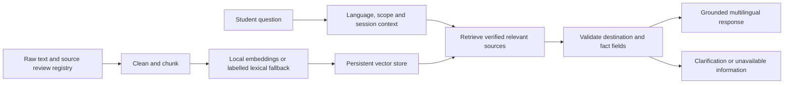

# TPC NavBot

[](https://tpcnavbottt-86x6mfwrmyvliw3xgpg2qp.streamlit.app/)

> **🌐 Live Deployed Application**: [https://tpcnavbottt-86x6mfwrmyvliw3xgpg2qp.streamlit.app/](https://tpcnavbottt-86x6mfwrmyvliw3xgpg2qp.streamlit.app/)  
> **Platform**: Streamlit Community Cloud (`randeleners4u/TPCNAVBOTTT`)  
> **Institution**: Talibon Polytechnic College (TPC), San Isidro, Talibon, Bohol  


The RAG optimization keeps the model and weights unchanged. Student-question
patterns are separate from approved campus facts; default retrieval combines
existing vectors with BM25 and checks claim-specific authority, dates, conflicts,
and source citations. See the [implementation and evaluation report](docs/13_rag_optimization_report.md)
for measured results, limitations, and regeneration commands for the derived Q&A.

A campus assistance prototype for Talibon Polytechnic College (TPC), with English, Bisaya, and Tagalog responses. The bot handles campus locations and supported campus services, rejects unrelated requests, and withholds unverified facts and routes.

**Data status:** `data/raw/` contains the original 30 generated samples (still
unverified) and 30 separate `school_confirmed_*.txt` records curated from the
user's school-confirmed submission. The user supplied reviewer **Flordelis
Tortuga**, review date **23 October 2026**, and reference **Admin and handbook**.
The review is recorded as school confirmation reported by the user; no independent
school verification by this software is claimed. Exact handbook edition/pages
and the reviewer's position were not supplied. Only the selected explicit facts
are approved; missing or ambiguous details remain unavailable. See
[the import and remaining gaps](docs/11_school_confirmed_records.md).

On 24 October 2026 the project maintainer directly confirmed that the BSIS /
Information Systems department office is inside the Main Building. The user then
confirmed the same building for the BSAIS, English/BAEL, Political Science/BAPS,
and Early Childhood Education/BECED offices, with advice to ask someone after
entering for the exact office. Five separate `user_confirmed_*_office.txt` sources
record those confirmations without adding unsupplied floor, room, hours, or staff.

Read [the requirements audit](docs/00_requirements_audit.md) for what is complete, partial, and still dependent on real-world evidence. The earlier README's claims of full checkpoint scores, verified documents, and completed deployment were unsupported.

The existing `TPC_NavBot_Checkpoint_1_Report.docx` is an obsolete report with unsupported grade/statistics and navigation claims. Use the corrected documentation and actual evaluation artifacts when preparing a submission.

## Run locally

From this directory:

```powershell
python -m venv .venv
.\.venv\Scripts\Activate.ps1
python -m pip install -r requirements-full.txt
Copy-Item .env.example .env
python run_app.py
```

Open `http://localhost:8501`. The app supports an offline, deterministic mode without a Gemini API key. Keep `.env` private. Check `.env.example` for optional settings; enable a cloud model only when that deployment is authorized to send student questions and candidate campus record fields to the provider.

The web interface uses a dark forest theme with jade and lime accents, a centered
welcome screen, and compact conversation styling. User messages appear in rounded
bubbles on the right; assistant answers and tips share a rounded bubble on the left.
Recommendations and feedback appear underneath the assistant bubble.
Multilingual question cards, a campus guide, and small follow-up chips help students
start and continue a conversation. Source references and review metadata remain
attached to each answer in session state. **New conversation** clears both the
active chat while keeping completed chats available in the session's **Chat history** list.
Selecting a previous chat restores its transcript and follow-up context. This history is
session-scoped and may be lost when the browser session ends. The guide
offers questions rather than claiming unverified office locations. Visual styles
live in `assets/styles.css`. The project and repository-root Streamlit theme
files stay aligned so the local preview and hosted application use the same colors.

Short queries such as `crim building`, `registrar`, and `comlab` work without a
full question. The question resolver and retrieval filter share campus aliases;
reviewed directory names are also recognized. Tips quote relevant details from
the selected approved record. Up to two follow-up buttons offer only fields
available for that destination. Unknown named facilities retain their names so
their questions cannot borrow another facility's hours or services.

The assistant checks up to three school questions in one message, handles
contextual follow-ups, and keeps missing fees, deadlines, access permissions,
and other specific details unconfirmed. Approved referral contacts can still
help students reach the right office. Explicit program questions distinguish
BSIS from BSAIS instead of returning the wrong overlapping title.
All seven reviewed programs have shared full-name, subject-name, and abbreviation
matching: BSIS, BSAIS, BSCRIM/Crim, BSAG/BSA/Agri, BAPS/PolSci, BAEL/English
department, and BECED/Education. Each department uses its own reviewed location;
Criminology and Agriculture retain their separately supplied building landmarks.
`List all departments` and equivalent questions in Bisaya or Tagalog return the
reviewed seven-program list. Individual program-offer questions return only the
requested title. Missing department details name the requested subject rather
than resetting the conversation to the assistant introduction.
Common student wording such as `Asa dapit makita ang registrar?`, `Saan makikita
ang registrar?`, and `Where do I go to get a student ID?` resolves to the relevant
reviewed office. Short follow-ups such as `Where is it?` and `What time does it
close?` keep the current destination; without a destination, the assistant asks
which office the student means. Floor and room questions require those exact facts.

Public chat input is limited to 600 characters and 120 words. The web app allows
12 messages per browser session per minute and 120 messages per process per
minute. These counters survive **New conversation**. Unicode/encoded injection,
credential disclosure, private-record requests, and operational hacking requests
are checked before retrieval or model selection. Legitimate account-recovery
and security-course questions remain eligible for supported school information.

Anonymous daily topic counts and optional thumbs feedback identify recurring
information gaps and rank follow-ups that already have verified answers. Raw
questions, answers, session identifiers, and personal details are not saved in
the learning database. Student claims cannot change school facts or source
approvals. This is a reviewed improvement workflow, not autonomous model training.

```powershell
python scripts/evaluate_school_qa.py --output data/evaluation/school_qa_final.json
python scripts/review_learning.py
```

The school benchmark checks 199 declared cases against the reviewed corpus,
including three languages, missing facts, multipart requests, and abuse cases.
It cannot establish accuracy for every possible question. See
[answer quality and continuous improvement](docs/12_answer_quality_and_learning.md)
for limits, review steps, and optional reviewed detail fields.

The application is actively deployed at **[https://tpcnavbottt-86x6mfwrmyvliw3xgpg2qp.streamlit.app/](https://tpcnavbottt-86x6mfwrmyvliw3xgpg2qp.streamlit.app/)**.

For Streamlit Community Cloud, the entrypoint is **`TPC Navbot/app.py`** relative
to the GitHub repository root. See [the exact deployment setup](docs/07_deployment_and_containerization.md#streamlit-community-cloud).

```powershell
python cli_chat.py
python -m src.ingestion --force
python tests/run_tests.py
python scripts/demo_checkpoint3.py
```

The regression suite uses explicitly fictional test fixtures to exercise verified-answer behavior. Test review records are not evidence about the actual TPC campus.

## Architecture



LangChain orchestration is used when the framework dependency is installed; a lightweight fallback keeps the core available offline. Optional Gemini selection is constrained to source IDs from retrieved evidence. The final response uses reviewed fact fields, so a generated route cannot enter the answer through the model.

`auto` embedding mode uses a locally available Sentence Transformers model when possible. If unavailable, it explicitly reports lexical hashing. The [measured lexical and semantic comparison](docs/04_distance_metric_report.md) identifies both actual backends and gives reproduction commands. Metric JSON outputs and local MiniLM weights are excluded from Git; provision a model explicitly on a fresh machine and set `TPC_EMBEDDING_MODEL` to its absolute local directory for semantic mode. The lexical fallback is not a semantic language model.

## Trust and route policy

Verification lives in `data/source_registry.json`, outside document text. A source is eligible only with a matching SHA-256, approved source type, official reference, reviewer, and review date. Editing reviewed source bytes invalidates that approval. Document headings such as "official" never grant trust.

Reviewed location fields and route fields are separate. A verified office location does not establish directions, walking time, accessibility, or a starting point. Missing route evidence produces a route-unavailable response. See [the verification workflow](docs/09_source_verification.md) before adding real campus information.

## Containers

```powershell
docker compose up --build
```

The Dockerfile uses separate build and runtime stages. The runtime runs as a non-root user. Configuration and credentials belong in deployment environment variables, not in the image or repository. Local container configuration is not proof of a cloud deployment. See [deployment and evidence requirements](docs/07_deployment_and_containerization.md).

## Project files

- `src/`: preprocessing, provenance checks, embeddings, vector retrieval, memory, and response orchestration.
- `data/raw/`: 30 generated sample documents; `data/source_registry.json`: review metadata.
- `app.py`, `cli_chat.py`: web and terminal interfaces.
- `tests/`, `scripts/`: regression tests, demo, and evaluation entry points.
- `docs/`: audit, proposal, data reflection, prompt design, measured metric comparison, framework comparison, customization rationale, deployment guide, final report, and defense plan.

## Evidence and attribution

The [metric comparison](docs/04_distance_metric_report.md) reports an actual offline run, including retrieval failures. It does not claim campus accuracy or a student usability study. No training experiment, live cloud API success, remote deployment, or completed defense is claimed without a retained artifact.

This project includes AI-assisted implementation and generated sample text. Review and explain that assistance in the course submission. The audit records the supplied semester guide and behavioral guidelines as requirements sources; official library documentation and research references appear in the relevant reports.
